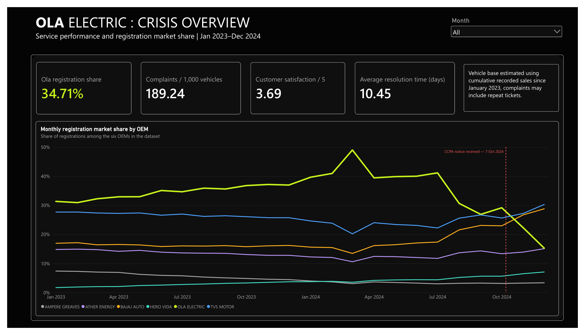

# Ola Electric Service Crisis Analysis

**Dasari Abhay | GUVI capstone | January 2023 - December 2024**

I analysed service complaints, workshop records, spare-part availability, sales and competitor registrations to understand how service pressure developed during 2024. The project combines PostgreSQL data preparation, a Power BI dashboard, Excel statistical analysis and a Botpress support prototype.

This is a student project using synthetic course data modelled on public events. Numerical findings are project results, not audited Ola Electric statistics. The chatbot is a demonstration, not an official support channel.

## Explore the project

- [Dashboard PDF](powerbi/Ola_Crisis_Analysis.pdf) - eight report pages, viewable without Power BI.
- [Final Power BI file](powerbi/Ola_Crisis_Analysis.pbix) - confirmed final dashboard; originally named `backup_Ola_Crisis_Star_Schema.pbix`.
- [Business analysis report](reports/crisis_analysis_report.pdf) and [data-quality report](reports/data_quality_report.pdf).
- [Main presentation and evidence notes](presentation/README.md).
- [Statistical workbook](analysis/Ola_Statistical_Analysis.xlsx).
- [SQL modules and execution notes](sql/README.md).
- [Chatbot evidence and impact method](chatbot/README.md).
- [Try the support demonstration](https://vdk-viber-runtime-prod.bot.botpress.host/edge/?botId=d9d95cda-60ba-4d80-8895-25fbef540aad).

## Findings

| Finding | Evidence | Interpretation |
| --- | --- | --- |
| Repairs slowed sharply | Mean resolution time rose from 6.93 days in January to 23.74 days in October 2024 | Prioritise aged repairs and parts availability |
| Dated complaints increased | 4,063 in January versus 9,553 in October 2024 | Service pressure rose before the December share low |
| Parts shortages were material | 20,330 of 62,400 centre-part-week records had stockouts, or 32.58% | Availability is a service constraint; this is not a count of unique calendar weeks |
| Customer-facing closure conflicted with workshop status | Later recorded snapshot: 3,870 job cards affecting 3,750 tickets | Preserve and reconcile both source statuses |
| Sales and complaints were associated within 2024 | Two-month lag correlation: -0.867 across 10 pairs; full-period result: -0.181 across 22 pairs | The relationship depends on the period and does not establish causation |
| Capacity allocation can be targeted | Proposed 100 additional centres across 22 of 30 service regions | At a fixed recorded vehicle base, the national ratio falls 13.9%; actual repair improvement is not forecast |

The cleaned-source load snapshot records **131,366 complaints**, **673,048 units sold** and **INR 70,311,073,972 in known revenue**. Revenue is unknown for 3,269 sales rows. The revenue total is not a crisis-loss estimate.

## What the repository contains

| Folder | Contents |
| --- | --- |
| `sql/` | Raw DDL, fresh cleaning, star schema, cleaned-source loading, validation and analytical queries |
| `powerbi/` | Final PBIX, dashboard PDF and viewing notes |
| `analysis/` | Excel analysis, monthly KPIs, service-region baseline and calculated allocation |
| `reports/` | Business and data-quality reports in PDF and editable Word formats |
| `presentation/` | Main deck and notes identifying its earlier chatbot assumptions |
| `chatbot/` | Intent design, fictional tickets, reference data, classification counts, sample projection and handoff evidence |
| `data/` | Original course README, challenge brief, 14 raw data files and FAQ |
| `assets/dashboard/` | Preview images rendered from the supplied dashboard PDF |
| `docs/` | Model grains, evidence boundaries and source inventory |
| `webpage/draft/` | Unfinished webpage source; not a deployed website |
| `archive/` | Superseded or alternate files retained for traceability |

## Methods and tools

**PostgreSQL / pgAdmin:** source-specific date parsing, city normalisation, legacy-sales precedence, duplicate handling, identifier mapping, dimensions and facts, constraints, indexes, views and cross-source checks.

**Power BI:** service and sales trends, city heatmaps, service-capacity ratios, parts analysis, illustrative sentiment, historical forecasting and complaint-reduction scenarios.

**Excel:** Welch's t-test, KPI correlations, forecast holdout calculations and operational warning rules.

**Botpress:** FAQ support and fictional ticket lookup, with human routing demonstrated in one safety case. The provided sample projects **13.98% eligibility**; at an assumed 60% self-service success rate, estimated deflection is **8.39%**, or about **11,021 ticket-equivalents**. This is not an observed result.

## Reproduction and scope

The [SQL guide](sql/README.md) distinguishes the fresh-import replay database from the completed analytical database. The original DML combined both workflows; the repository separates them without changing their SQL statements. It is not a verified one-command raw-to-dashboard pipeline.

The dashboard can be reviewed from the PDF without database access. Refreshing the PBIX requires the PostgreSQL source and appropriate local credentials. The file is preserved unchanged and has not been refreshed during packaging.

The [model notes](docs/model.md) describe table grains and the [evidence notes](docs/evidence.md) explain assumptions, snapshot differences and the presentation update.

The webpage remains under development. No GitHub Pages deployment is included.

## Author and attribution

[Dasari Abhay on GitHub](https://github.com/DasariAbhay) · [LinkedIn](https://www.linkedin.com/in/dassari-a-40a252432/)

The dataset, challenge brief and original FAQ were provided through the GUVI course. Their original content is retained under `data/`. No additional licence for third-party course material is asserted by this repository.
